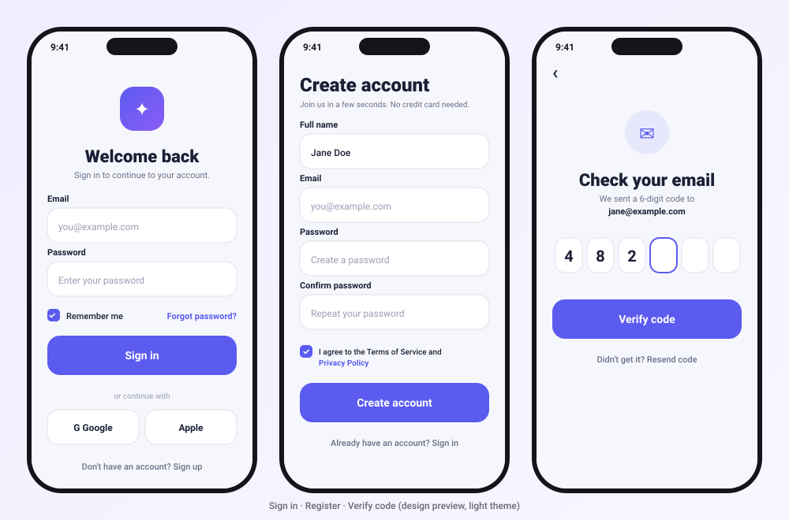

# Flutter Login UI Kit

<p align="center"></p>

<sub>Preview: design illustration of the screens, in the light theme. Run the app to see the real thing.</sub>

A free, beautiful and responsive authentication UI kit for Flutter. Login, sign up, forgot password, 6-digit code verification and reset password, with light and dark themes and zero third-party packages. Copy it into your app and plug in your own backend.

## Screens

| Screen | What it includes |
|---|---|
| **Login** | Email and password with validation, show/hide password, remember me, forgot password link, Google and Apple buttons, link to sign up |
| **Sign up** | Name, email, password with strength meter, confirm password, terms checkbox |
| **Forgot password** | Email field that sends a reset code |
| **Verify code (OTP)** | 6-digit code boxes (paste and autofill friendly), resend countdown |
| **Reset password** | New password with strength meter, confirm, success state |

## Features

- Material 3 design with a gradient brand color you can change in one line
- Light and dark mode (follows the system setting)
- Responsive: phone layout, and a split screen with a branded panel on wide screens (900px and up)
- Form validation with clear error messages
- Loading states on every button
- Smooth entrance animations
- No dependencies besides Flutter itself

## Getting Started

1. Clone this repository
2. Generate the platform folders you need (this repo ships the Dart code only):

   ```bash
   flutter create --platforms=android,ios,web .
   ```

   If it replaces any of the project files, restore them with `git checkout -- lib test pubspec.yaml`.
3. Install packages and run:

   ```bash
   flutter pub get
   flutter run
   ```

## Connect Your Backend

Every screen has a `TODO` comment where the fake delay is. Replace it with your real request:

| File | Replace with |
|---|---|
| `lib/screens/login_screen.dart` | Sign-in request |
| `lib/screens/register_screen.dart` | Sign-up request |
| `lib/screens/forgot_password_screen.dart` | "Send reset code" request |
| `lib/screens/otp_screen.dart` | Code verification and resend |
| `lib/screens/reset_password_screen.dart` | Save new password |

The Google and Apple buttons are UI only. Connect them with the sign-in package of your choice.

## Customize

Colors live in `lib/theme/app_theme.dart`:

```dart
static const Color brand = Color(0xFF5B5BF0);
static const Color brandAlt = Color(0xFF8B5CF6);
```

Reusable pieces (fields, buttons, strength meter, page layout) are in `lib/widgets/auth_widgets.dart`, and the validators are in `lib/utils/validators.dart`.

## Project Structure

```
lib/
├── main.dart
├── theme/app_theme.dart
├── utils/validators.dart
├── widgets/auth_widgets.dart
└── screens/
    ├── login_screen.dart
    ├── register_screen.dart
    ├── forgot_password_screen.dart
    ├── otp_screen.dart
    └── reset_password_screen.dart
test/widget_test.dart
```

## License

MIT. Free to use for personal or commercial projects. A link back is appreciated but not required.

Made by [Leni Junior](https://github.com/lenivalestevao). Check out my other free templates on my profile.
